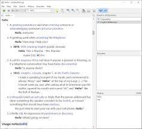
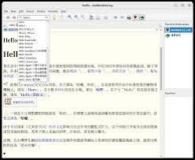

# GoldenDict-ng for Reading Across Multiple Dictionary Sources

A word in a novel, a technical term and an unfamiliar inflection call for different reference material. GoldenDict-ng lets you consult several dictionaries in one window, then narrow the search to the sources that suit the text.

[](https://goldendict-ng.github.io/GoldenDict-ng/)

## Choose the search that matches the question

| What you have | Where to look |
| --- | --- |
| A word whose definition you need | Main lookup field |
| A word embedded somewhere in an explanation | Full-text search |
| Several possible inflected forms | A group with suitable Hunspell morphology sources |
| Too many unrelated definitions | A smaller dictionary group |

Add your own dictionary folders through `Edit > Dictionaries > Sources > Files`.
Enable recursive scanning when dictionaries live in subfolders, then review the discovered entries.
The [source management guide](https://xiaoyifang.github.io/goldendict-ng/manage_sources/) describes local files, morphology and other source types.

For goldendict ng dictionaries, keep accompanying resources together with the main dictionary data.
Create a group for a language pair or subject instead of searching every source on every lookup.
See the [group guide](https://xiaoyifang.github.io/goldendict-ng/manage_groups/) for manual and automatic grouping.

Case handling and morphology solve different problems: removing case distinctions does not supply every missing word form.
Hunspell results depend on the morphological rules available in the selected language data.
The Unicode data generator is documented in [README.md](tools/generators/README.md).
Its implementation, [generate.cc](tools/generators/generate.cc), consumes Unicode data including [CaseFolding.txt](tools/generators/CaseFolding.txt).
These files explain a supporting text-processing mechanism rather than providing dictionary definitions.

## Bring a lookup back to your reading window

The command line can target a dictionary group and choose the main window or scan popup.
Create a group named `Reading` before trying these two independent lookup examples:

```bash
goldendict --group-name "Reading" --main-window "observatory"
goldendict --popup-group-name "Reading" --popup "constellation"
```

The executable may be named `goldendict-ng` by your package; use the name supplied by that installation.
The [CLI reference](https://xiaoyifang.github.io/goldendict-ng/cli/) documents supported options and argument forwarding to an existing instance.

- Use the main window when comparing long articles.
- Use the popup for a brief interruption while reading.
- Keep the popup group focused if the main group contains many specialist sources.
- Test desktop shortcuts in the actual session where you read, especially on Wayland.

<details>
<summary>Included single-instance component references</summary>

The Qt Solutions component overview is in [README.TXT](thirdparty/qtsingleapplication/README.TXT).
[qtsingleapplication.h](thirdparty/qtsingleapplication/src/qtsingleapplication.h) declares the application interface.
[qtsingleapplication.cpp](thirdparty/qtsingleapplication/src/qtsingleapplication.cpp) implements it.
[qtlocalpeer.h](thirdparty/qtsingleapplication/src/qtlocalpeer.h) declares the local peer used for communication.

</details>

## Make long articles easier to read

Adjust article styling separately from the surrounding application interface.
The [style customization guide](https://xiaoyifang.github.io/goldendict-ng/topic_userstyle/) explains the configuration folder and stylesheet names.
For example, a user-created `article-style.css` can increase line spacing and underline links:

```css
body {
  line-height: 1.65;
}
a {
  text-decoration: underline;
}
```

Restart the application after saving the stylesheet.
Review a text-heavy entry and an illustrated entry, since dictionaries can supply their own formatting.
Keep changes small enough that labels, pronunciation controls and tables remain recognizable.



The embedded resource list is [resources.qrc](resources.qrc).
Chinese WebEngine translation support is described in [README.md](thirdparty/qwebengine_ts/README.md).
[qtwebengine_zh_CN.ts](thirdparty/qwebengine_ts/qtwebengine_zh_CN.ts) contains translation source text; [qtwebengine_zh_CN.qm](thirdparty/qwebengine_ts/qtwebengine_zh_CN.qm) is its compiled counterpart.
Article CSS changes presentation, while these translation resources concern WebEngine interface text.

## Turn a useful definition into a review card

GoldenDict-ng can work with Anki through the AnkiConnect add-on.
Select a note type and map the vocabulary and definition fields in the application's Anki preferences.
The [Anki integration guide](https://xiaoyifang.github.io/goldendict-ng/topic_anki/) explains the field mappings.

Choose a short definition that fits the meaning encountered in the text.
Include context when two senses of the same word would otherwise look identical.
Check the resulting note before sending a larger batch of vocabulary.

For a note type with a `Front` field containing a simple headword, this HTML fragment adds a return link in an Anki card template:

```html
<div class="dictionary-reference">
  <a href="goldendict://{{Front}}?target=main">Review this word in GoldenDict-ng</a>
</div>
```

The operating system must associate the `goldendict` URI scheme with the application.
Terms containing reserved URI characters need URL encoding before they are placed in a link.



## Keep the same reference collection on another machine

For goldendict ng portable use, follow the [portable mode layout](https://xiaoyifang.github.io/goldendict-ng/topic_portablemode/).
A `portable` folder beside the executable holds configuration and indexes.
Dictionary files belong under the adjacent `content` folder.
Retain accompanying media and morphology files when moving the collection.

The application package must still match the destination operating system.
The supplied packaging references identify how each platform receives its application files:

| Platform | Packaging reference | Integration reference |
| --- | --- | --- |
| Linux | [Package_Linux.cmake](cmake/Package_Linux.cmake) | [io.github.xiaoyifang.goldendict_ng.desktop](redist/io.github.xiaoyifang.goldendict_ng.desktop) |
| Windows | [Package_Windows.cmake](cmake/Package_Windows.cmake) | Runtime deployment rules in the packaging script |
| macOS | [Package_macOS.cmake](cmake/Package_macOS.cmake) | [mac_info_plist_template_cmake.plist](redist/mac_info_plist_template_cmake.plist) |

For goldendict ng linux builds, [Deps_Linux.cmake](cmake/Deps_Linux.cmake) lists dependencies such as Hunspell and Xapian.
[Deps_macOS.cmake](cmake/Deps_macOS.cmake) handles macOS dependencies, and [Deps_Vcpkg.cmake](cmake/Deps_Vcpkg.cmake) supplies vcpkg-related dependency integration.
The registry baseline is recorded in [vcpkg-configuration.json](vcpkg-configuration.json).
[io.github.xiaoyifang.goldendict_ng.metainfo.xml](redist/io.github.xiaoyifang.goldendict_ng.metainfo.xml) supplies application metadata for software catalogs.

## Let indexing finish before judging responsiveness

Full-text search examines article bodies in the current dictionary group.
Open it through `Search` or `Ctrl+Shift+F`, then check which dictionaries have finished indexing.
Large sources can consume substantial CPU time and disk space during this process.
The [full-text search guide](https://xiaoyifang.github.io/goldendict-ng/ui_fulltextsearch/) describes indexing controls and search modes.

The supplied [startup_optimization.md](docs/startup_optimization.md) records work on deferring startup tasks.
Its timing notes describe that implementation work and should not be treated as a fixed startup promise.
[VERSION](VERSION) records the version associated with these materials; [CREDITS.txt](CREDITS.txt) acknowledges contributors.

## Related Search Terms

GoldenDict-ng, GoldenDict-ng, goldendict ng linux, goldendict ng dictionaries, goldendict ng portable, dictionary, dictionary-software, goldendict, qt6, webengine, stardict, mdict, lingvo, anki, full-text-search
